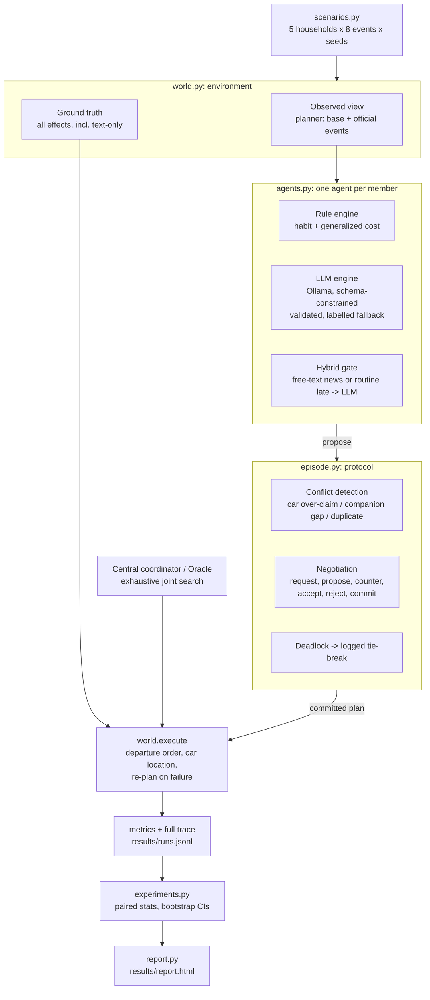

# Architecture

## Modules

| file | responsibility | lines of interest |
|---|---|---|
| `hmcoop/model.py` | data types, declared cost weights | `Member`, `Event`, `Option`, `Message` |
| `hmcoop/scenarios.py` | 5 synthetic households, 8 event templates, seeded jitter | `make_scenario` |
| `hmcoop/world.py` | observed vs. true conditions, option enumeration, validation, physical execution with car locations | `Conditions`, `validate`, `execute` |
| `hmcoop/llm.py` | instrumented Ollama client: latency, tokens, raw text, JSON-schema check, on-disk cache | `OllamaClient.chat` |
| `hmcoop/agents.py` | rule / LLM / hybrid engines; decision, car-conflict and companion replies | `Agent.decide`, `car_reply`, `escort_reply` |
| `hmcoop/episode.py` | one morning: proposals, negotiation protocol, commit, execution; central and oracle baselines | `Episode.run`, `central_plan` |
| `hmcoop/experiments.py` | resumable factorial runner and paired analysis | `run`, `analyze` |
| `hmcoop/report.py` | static results page built only from result files | `build` |

## Design choices that matter in an interview

- **Same information for every engine.** The planner reflects only official events; free text is given to everyone.
  Differences between engines come from what they do with the information, not from what they were given.
- **Physical execution is separate from intentions.** Two parents both *planning* to take the only car is a planned
  conflict. One of them finding the car gone at 07:45 is an execution failure. The two are counted separately.
- **The LLM proposes, the environment disposes.** The LLM picks among enumerated, individually feasible options.
  The household-level constraints (one car, one companion) are checked by the protocol, and any violation that
  remains is recorded, never repaired silently.
- **No fake LLM.** LLM and hybrid conditions refuse to run without a reachable model. Fallbacks are labelled
  `fallback`, protocol tie-breaks are labelled `protocol`, and both are counted.
- **Standard library only.** Nothing to install except Ollama, so a reviewer can rerun everything.

## Relation to the team's platform (Ytlse/generative-agents-urban-mobility)

That platform already has a GAMA world, OpenTripPlanner/OSMnx routing, a Python controller, a multi-provider
LLM gateway, memory, a vehicle-chain feasibility rule, and decision-makers that return probability distributions
over itineraries. This POC does not replace any of that. The part that could transfer is the **decision-time
household protocol** and the **hybrid gate**: in the platform's terms, a step between "feasible itineraries per
member" and "draw the executed option", where members holding conflicting claims on a household vehicle or a
child's trip negotiate before the draw. Adapting it would mean consuming the controller's itinerary sets
instead of `enumerate_options`, and returning a distribution rather than an argmax. Not implemented here.
